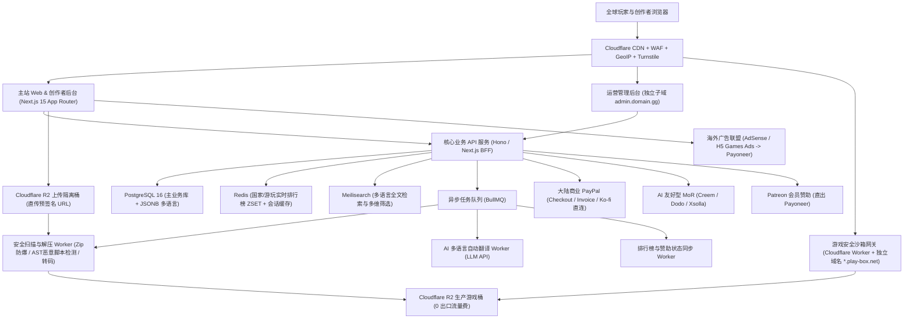
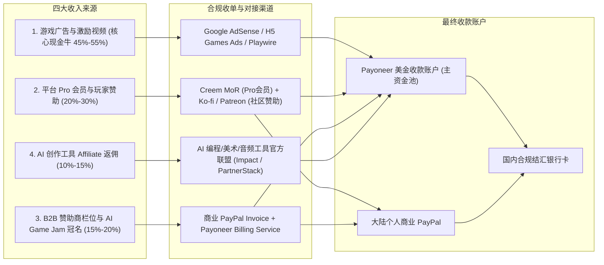
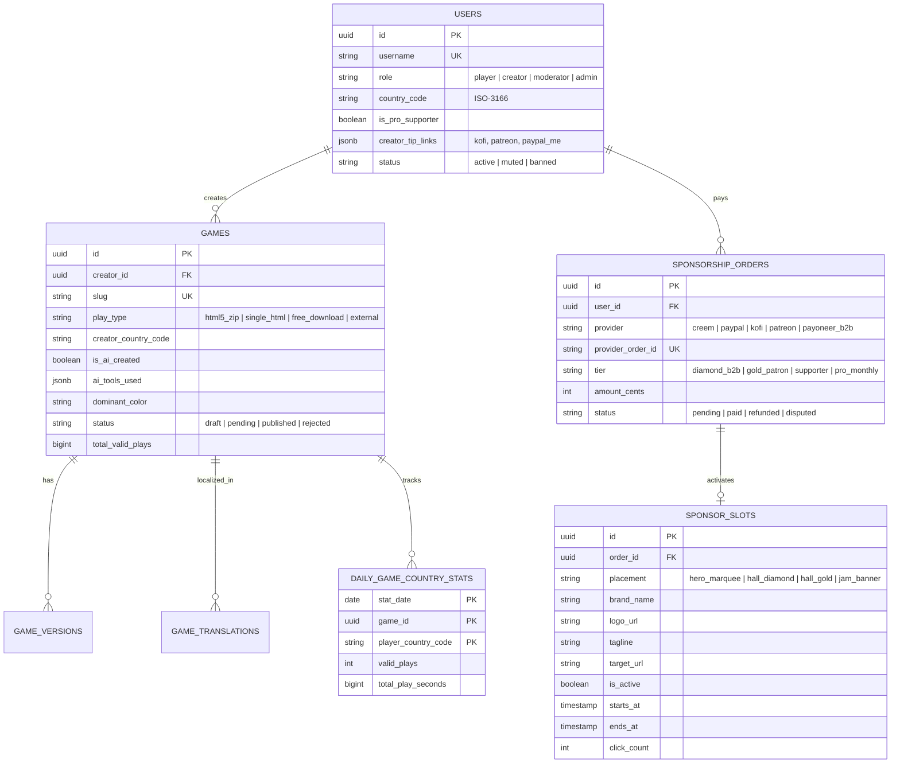

# 全球免费 & AI 自创游戏平台 — 完整项目架构蓝图（v2 修订版）

> [!IMPORTANT]
> 本版架构已结合你的实际资源与最新行业变化完成定向修订：
> 1. 新增 **品牌命名与双域名搭配方案**（配套交互式视觉预览页 [style_preview.html](file:///home/antigravity/.gemini/jetski/brain/v1/default/jetski_remote_agents_3p_devbox/1fa22833-4a19-48c9-8ee5-cce5057ea61c/style_preview.html)）。
> 2. 完整评估 **Hostinger 企业版托管 + 现有 `globalfacthub.com` VPS**，并给出 4 种部署架构的 2026 年真实月度成本对比。
> 3. **已移除即将关停的 Lemon Squeezy（2026 年 11 月 16 日已关闭新注册，2027 年 3 月 31 日关停）及拒审 AI 的 Paddle**，替换为 2026 年实测支持中国大陆开发者 + AI 友好型 MoR/赞助通道组合。
> 4. 新增全站 **五大赞助专属展示栏位系统**，明确大陆商业 PayPal Invoice 与 Payoneer 账单收款实操方式。

---

## 1. 品牌命名与双域名方案（主站域 + 安全沙箱域）

因为平台允许用户上传 HTML5/JS 代码在线游玩，**架构上必须准备两个独立根域名**：一个用于主站与用户登录态，另一个低成本域名专用于游戏运行沙箱（彻底隔离 Cookie 防 XSS）。

| 推荐方案 | 品牌名 | 风格契合度 | 建议主站域名（任选其一） | 建议沙箱隔离域名（年费约 \$2-\$10） | 品牌释义 |
| :--- | :--- | :--- | :--- | :--- | :--- |
| **方案 A（推荐全能）** | **NEXARC** | 赛博街机 / 星际通吃 | `nexarc.gg` / `nexarc.games` / `nexarc.io` | `nexarc-play.net` / `nexarc-box.xyz` | Next-Gen + Arcade / Nexus Arc，短小好记、全球游戏辨识度极高 |
| **方案 B（偏星际指挥舱）** | **ORBITPLAY** | 科幻星际指挥舱首选 | `orbitplay.gg` / `orbitplay.io` / `orbitplay.games` | `orbitplay-run.net` / `orbit-sandbox.xyz` | 星轨游玩，天然呼应“3D 全球国家热度地球 + 国家排行榜”核心卖点 |
| **方案 C（偏赛博街机）** | **FLUXARC** | 赛博霓虹街机首选 | `fluxarc.gg` / `fluxarc.com` / `fluxarc.play` | `fluxarc-run.net` | Flux（流光动态）+ Arcade（街机），强调大面积流光视觉冲击 |
| **方案 D（已拍板启用）** | **SYNTHPLAY** | 赛博霓虹街机（已确定） | **`synthplay.games`**（后台 `admin.synthplay.games`） | **`synthplay-box.cloud`**（CDN `cdn.synthplay-box.cloud`） | Synthetic（AI 合成创作）+ Play，直观传递“AI 自创免费游戏”定位 |

> [!TIP]
> 全球游戏平台最推荐使用 **`.gg`**（海外玩家对 `.gg` 的游戏心智最强，如 `Discord.gg`、`OP.GG`）或 **`.games` / `.com` / `.io`**；沙箱域名对用户不可见，只需在 Cloudflare Registrar 选一个成本价 `.net` 或 `.xyz` 即可。

---

## 2. 系统总体技术架构

### 2.1 系统分层与网络拓扑

### 2.2 核心技术栈选型

| 层级 | 推荐选型 | 选型理由 |
| :--- | :--- | :--- |
| **工程结构** | `pnpm` + `Turborepo` Monorepo | 统一维护前台、管理后台、数据库 Schema、i18n 与游戏 SDK |
| **前台框架** | **Next.js 15 (App Router)** + TypeScript + Tailwind CSS v4 | 强 SEO（多语言 SSR/ISR）、组件生态完善 |
| **大面积动态引擎** | **Three.js / R3F + 自定义 GLSL Shaders + GSAP + Motion + Lenis + COBE** | 全屏流体/赛博网格背景、3D 国家地球、卡片 3D 扫光、游玩态自动休眠释放 GPU |
| **管理后台** | Next.js 独立应用 (`apps/admin`) + `shadcn/ui` + `TanStack Table` + `ECharts` | 轻快高效、不加载前台重动效、数据报表直观 |
| **数据存储** | **PostgreSQL 16 (Drizzle ORM)** + **Redis** + **Meilisearch** | PG 保障交易一致；Redis `ZSET` 扛住毫秒级全球/国家榜 |
| **文件与 CDN** | **Cloudflare R2 + CDN + Workers** | **0 出口流量费**，免费游戏平台长期运营的生死底线 |
| **多语言** | `next-intl` + 异步 LLM 翻译 | 静态 UI 词条 + UGC 游戏多语言自动翻译 + `hreflang` SEO |

---

## 3. Hostinger 资源评估与全部署方案成本对比（2026 最新）

> [!CAUTION]
> **安全提醒：请勿在对话中发送你的 Hostinger 账号密码！** 我们不需要登录你的账户即可评估。如想确认现有 VPS 剩余容量，你只需告诉我 VPS 套餐档位（如 KVM 1 / KVM 2 / KVM 4），或在终端运行一次只读命令 `free -h && nproc && df -h` 把硬件剩余数字发给我即可。

### 3.1 你现有 Hostinger 资源的技术评估

1. **Hostinger 企业版网站托管（Business / Unlimited Shared Web Hosting）**：
   - **结论：不适合部署本游戏平台。**
   - 原因：它属于共享 PHP/WordPress 主机，无法常驻运行 PostgreSQL、Redis、Meilisearch、BullMQ 后台 ZIP 解压扫描 Worker，且高并发下会直接触发 I/O 与进程数封顶限制。
2. **Hostinger 现有 VPS（运行 `globalfacthub.com`）**：
   - **若是 KVM 1（1 vCPU / 4GB RAM）**：**强烈不建议共用**，游戏上传解压扫描和突发流量会拖慢甚至挤垮 `globalfacthub.com`。
   - **若是 KVM 2（2 vCPU / 8GB RAM）或 KVM 4（4 vCPU / 16GB RAM）且 `globalfacthub.com` 负载偏低（内存空余 >= 4GB）**：可以通过 **Docker Compose 严格资源限额**（如限制游戏平台最多使用 `1 vCPU / 2.5GB RAM`）+ Nginx/Caddy 反代安全共存；但若 `globalfacthub.com` 是核心生产站，从安全隔离角度（防上传扫描突发 CPU 或故障连带）仍推荐独立一台低价 VPS。

### 3.2 四种部署方案 2026 真实月度成本对比

| 部署方案 | 核心配置与托管组成 | 初期月成本（日活 < 1万） | 成长月成本（日活 3-5万 / 2TB流量） | 优缺点与推荐度 |
| :--- | :--- | :---: | :---: | :--- |
| **方案 A：复用现有 Hostinger VPS + Cloudflare R2** | 现有 VPS Docker 限额隔离部署（Next.js + API + PG + Redis + Worker）+ Cloudflare R2（10GB 免费，0 流量费）+ 双域名均摊 + AI 翻译 | **\$4 - \$9 / 月** | **\$12 - \$20 / 月**（仅增 R2 存储与翻译） | **最省钱**；前提是现有 VPS >= KVM 2 且有余量；存在与主站同机隔离风险 |
| **方案 B：独立高性价比 VPS + Cloudflare R2（强烈推荐）** | 新购 **Hetzner CX23/CX33**（2C4G 约 \$6.5/月，4C8G 约 \$9.8/月）或 **Hostinger KVM 2**（2C8G 促销 \$7-\$9/月）+ Docker 自建全套 + Cloudflare R2 + 双域名 + AI 翻译 | **\$11 - \$18 / 月** | **\$18 - \$30 / 月**（R2 出站免费，无流量刺客） | **性价比与安全性双最优！** 彻底隔离 `globalfacthub.com`，无 Serverless 突发天价账单 |
| **方案 C：Cloudflare Workers + 托管库（混合云原生）** | Cloudflare Workers Paid（\$5/月，含 1000 万请求、0 带宽费）+ R2 + Neon/Supabase PG + Upstash Redis + 轻量扫描容器 | **\$10 - \$20 / 月**（含免费额度） | **\$40 - \$65 / 月**（托管库升级费用） | 全球边缘响应极快，免运维数据库；但 ZIP 扫描/视频转码仍需一台小容器 |
| **方案 D：Vercel Pro 全托管（不推荐）** | Vercel Pro（\$20/月起，含 1TB，超出 \$0.15/GB；商用不可用免费 Hobby 版）+ Supabase Pro（\$25/月）+ Upstash（\$10/月） | **\$55+ / 月** | **\$150 - \$250+ / 月**（流量账单暴涨） | 开发体验最好，但对高流量的免费游戏站极不划算 |

---

## 4. 盈利模式、赞助专属展示体系与 2026 实测收款方案

### 4.1 关键痛点核查结论（2026 年 11 月实测）

1. **关于大陆个人商业 PayPal 能否开发票（PayPal Invoice）**：
   - **可以开具 PayPal 官方电子收款账单（PayPal Invoice）！**（注：这是面向海外客户的英文商业收款单/收据，不是中国国内税务局的增值税发票）。
   - 你可以直接在大陆商业 PayPal 后台免费生成带项目明细的 Invoice 发送给海外赞助商邮箱，对方可直接用 PayPal 或信用卡付款；同时，**Payoneer 后台自带「请求付款（Billing Service）」**，也能给海外 B2B 赞助商发送正式付款请求并直接收美金进 Payoneer。
   - **唯一红线**：大陆 PayPal 不能接收另一个大陆 PayPal 账户付款，仅面向海外赞助商与海外玩家。
2. **关于海外 MoR（代理商户）2026 最新格局**：
   - ❌ **Lemon Squeezy**：已于 **2026 年 11 月 16 日停止新商户注册**，并将于 **2027 年 3 月 31 日彻底关停**，已从架构彻底剔除。
   - ❌ **Paddle**：对 AI 生成与独立内容审核极严，极易拒审或封号，已彻底剔除。
   - ✅ **2026 年适配「中国大陆开发者 + AI 游戏平台」的最佳替代方案矩阵**：

| 通道名称 | 角色定位 | 2026 实测费率 | 大陆开发者与提现支持 | AI 游戏平台过审与适配策略 |
| :--- | :--- | :--- | :--- | :--- |
| **Creem (`creem.io`)** | **首选海外 MoR**（全球信用卡 / Apple Pay / Google Pay / 订阅 + 代缴全球 VAT） | **3.9% + \$0.40**（无月费、无跨境附加费） | **官方明确支持中国大陆个人开发者！** 支持银行电汇（\$7 或 1%）、甚至支持**大陆个人支付宝直接提现**（单笔最高 5万 CNY） | 主打 AI 时代独立开发；**避坑关键**：商品描述定位于**「Web 游戏社区 Pro 会员（去广告、云存档、动态勋章、高阶托管配额）」**而非裸卖生成式 AI 图片/内容，过审率极高 |
| **Dodo Payments** | **备选 MoR**（信用卡 / 订阅 / 数字商品 + 全球税务） | 4% + \$0.40（跨境 +1.5%，订阅 +0.5%） | 支持全球独立开发者银行打款（可与 Creem 同步申请作为热备） | 定位贴近原 Lemon Squeezy 替代，适合作为双通道冗余 |
| **Ko-fi** | **零审核门槛海外赞助收银台**（直连你的商业 PayPal） | 一次性打赏 **0% 平台费**（仅扣 PayPal 费；注意后台关掉默认 5% 开关）；会员 5% | 直接绑定**大陆商业 PayPal** 收海外赞助，自带 Webhook 自动回调点亮站内赞助墙 | 极度适合游戏社区！零复杂审核，上线第一天就能跑通赞助闭环 |
| **Patreon** | **海外玩家最信赖的月度赞助平台** | 10% 平台费 + 支付手续费 | **官方原生支持 Payoneer 美金户提现！** | 适合经营平台官方“幕后开发与服务器众筹俱乐部”，海外游戏玩家转化率高 |
| **Xsolla** | **游戏行业垂直 MoR 王者**（进阶期） | 约 5% 起（支持 1000+ 全球本地支付） | 支持电汇与 Payoneer 结算 | 专为游戏设计，彻底不歧视游戏/AI 业务，适合月流水过 \$5,000 后接入 |

### 4.2 四层复合盈利路由图

### 4.3 全站五大「赞助专属展示栏位」系统设计

为了将赞助转化为持续现金流并兼顾酷炫视觉，平台将在前台与后台内置一套完整的 **赞助位管理系统（Sponsor Slot CMS）**：

1. **栏位 1 — 首页顶部动态赞助商铭牌带（Hero Sponsor Marquee）**
   - 位置：Hero 主视觉下方贯穿全屏的霓虹/星轨流光滚屏条。
   - 展示内容：B2B 冠名商与钻石赞助商 Logo、一句 Slogan、发光外链（支持 `rel="sponsored"` 与点击统计）。
2. **栏位 2 — 首页独立「荣耀赞助大厅（Hall of Patrons）」**
   - 分三档高视觉权重卡片：
     - **💎 传奇冠名商（B2B / \$199+/月）**：全息大卡片、品牌动效 Logo、定制简介、直达官网按钮。
     - **⚡ 黄金赞助者（\$25-\$99）**：霓虹/星环发光铭牌、自定义头像、个性宣言与个人链接。
     - **🌟 社区支持者（\$5+ / Pro 会员）**：流动星尘/霓虹墙展示昵称与国家国旗徽章。
3. **栏位 3 — 实时「平台算力与赛事众筹能量条（Live Funding Bar）」**
   - 展示本月「全球 CDN 服务器 + 下届 AI Game Jam 奖金池」众筹百分比（如 `78% — \$390 / \$500`），附一键赞助弹窗，显著拉升海外社区打赏意愿。
4. **栏位 4 — 游戏游玩页「双轨赞助舱（Game Page Sponsor Dock）」**
   - 左侧：**创作者直连打赏卡**（创作者自定义 Ko-fi/Patreon/PayPal.me，**平台 0 抽成**，彻底规避二清风险并疯狂吸引开发者入驻）。
   - 右侧：**平台 Pro 去广告 / 赞助本平台入口**。
5. **栏位 5 — 国家榜 & AI Game Jam 冠名位（Leaderboard & Jam Partner Banner）**
   - 每月 AI 游戏黑客松和国家排行榜顶部预留专属冠名商视觉位（如 *“Presented by [AI 工具品牌]”*），高客单价直接通过 PayPal Invoice / Payoneer 收款。

---

## 5. 全平台功能矩阵、安全沙箱、数据库与多语言架构

### 5.1 前台 / 创作者后台 / 运营管理后台核心模块

- **前台门户**：
  - 大面积动态视觉首页（全屏着色器背景 + 3D 全球热度地球 + 3D 卡片扫光 + 悬停动态预览 + **游玩态 GPU 零抢占休眠机制** + 三档画质自适应）。
  - **国家分类 & 三维国家排行**：按玩家 GeoIP 聚合的「各国热门游玩榜」、按创作者国籍统计的「国家创作力总榜」、以及「本国原创精选榜」；叠加全球日/周/月/飙升榜与 AI 专项榜。
  - **AI 游戏专属生态**：AI 工具栈标签（自然嵌套 Affiliate 变现链接）、AI Prompt / 制作幕后卡、AI Game Jam 专题赛。
- **用户与创作者后台（Creator Studio）**：
  - **双模极速上传**：标准 HTML5/WebGL/Unity/Godot `.zip` 拖拽上传 + **AI 单文件 HTML「粘贴即发布」** + 免费安装包/外链登记；版本预览与回滚。
  - 一键 AI 翻译多语言元数据、分国家游玩热力图分析、打赏外链与收益提现管理。
- **运营与用户管理后台（Admin Console）**：
  - RBAC 多角色权限 + 审计日志；用户检索/认证/风控/封禁；待审游戏**内置安全沙箱试玩审查** + 自动安全报告；榜单防刷干预；**五大赞助位可视化排期管理（含过期自动下架与点击统计）**；i18n 词条 CMS；财务订单与提现审批。

### 5.2 在线游戏安全沙箱五重防线

1. **双独立根域隔离**：主站域（如 `nexarc.gg`）与沙箱域（如 `*.nexarc-play.net`）完全隔离，杜绝恶意游戏 JS 窃取主站登录态。
2. **严格 `iframe sandbox` 与 CSP**：禁用顶层跳转，默认封锁未知第三方外联。
3. **R2 隔离桶预签名直传 + 异步安检 Worker**：防 Zip 炸弹（解压 <= 200MB）、白名单扩展名、AST 恶意脚本/挖矿检测。
4. **Cloudflare Worker 防盗链**：校验 `Referer` 与短期签名 Token，防止采集站盗嵌。
5. **反刷榜心跳**：页面可见游玩满 30 秒才计 1 次有效游玩 + Cloudflare Turnstile 无感人机校验 + Redis `ZSET` 实时聚合。

### 5.3 核心数据库实体概览（新增 `sponsor_slots` 赞助栏位表）

### 5.4 多语言策略与冷启动运营路线

- **首发 4 语种（`en` / `zh-CN` / `ja` / `es`）-> 首月扩至 8 语种（`ko` / `pt-BR` / `zh-TW` / `ar` RTL）**；UI 静态词条 + LLM 异步翻译 UGC 游戏详情 + `hreflang` 多语言 SEO。
- **冷启动三板斧**：自制 5-8 款爆款 AI 示范游戏 + 合规署名引入 MIT/CC 开源精品 H5 游戏 + 去 X/Reddit/Discord 邀请 AI Vibe Coding 开发者（卖点：粘贴 HTML 秒发布 + 0 抽成挂打赏链接 + 国家榜单曝光）。
- **病毒增长**：短视频录屏发 TikTok/Shorts/B站 + 每周「国家游戏创作力榜」裂变海报 + 月度 AI 48h Game Jam。

---

## 6. 研发分阶段规划（待确认风格与部署方案后启动）

- **Phase 1（MVP 闭环，第 1-4 周）**：确定最终视觉风格与品牌名 -> 搭建 Monorepo（前台 + 管理后台 + DB Schema + i18n）-> 落地大面积动态视觉前台与五大赞助展示栏位 -> 实现国家分类、游玩榜/国家榜 -> 实现 ZIP / 单文件 AI HTML 上传与安全沙箱 -> 用户后台与管理后台核心闭环 -> 接入 Ko-fi/商业 PayPal 赞助回调并预留 Creem MoR 接口。
- **Phase 2（商业化与增长，第 5-8 周）**：3D 全球热度交互地球 + `aigame-sdk.js`（云存档/高分榜/激励视频广告）+ Google AdSense / H5 广告联盟（回款 Payoneer）+ Creem MoR 订阅上线 + AI 自动多语言翻译。
- **Phase 3（生态深化，第 9-12 周+）**：创作者广告分成自动结算体系 + 在线 AI 轻量代码沙盒编辑器 + B2B 赞助自助排期系统。
